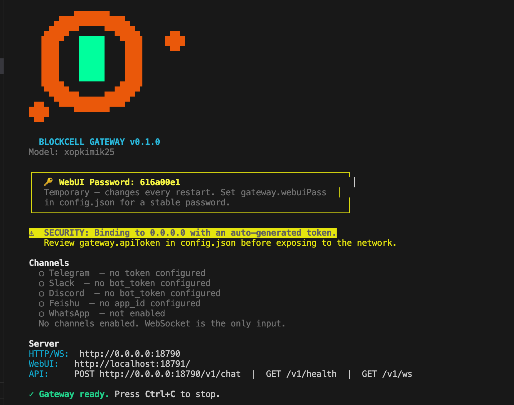
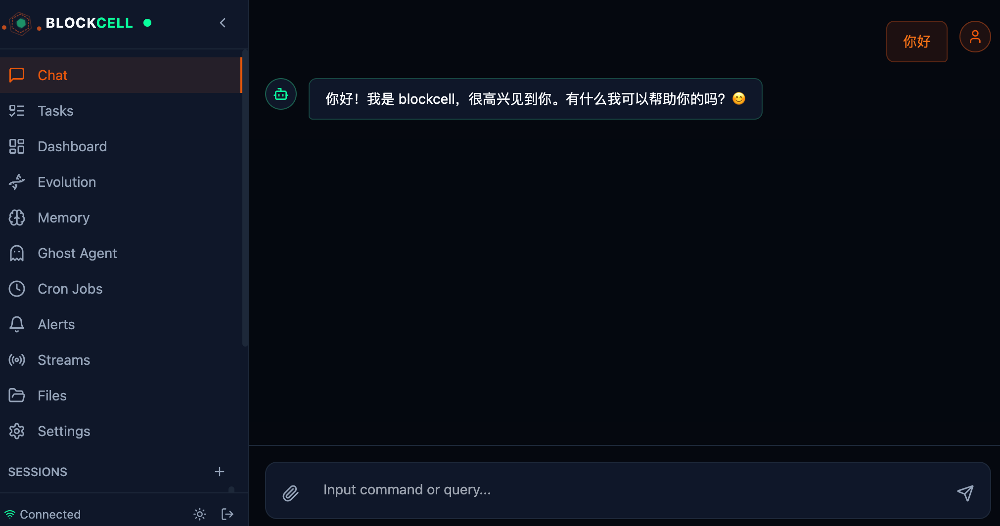
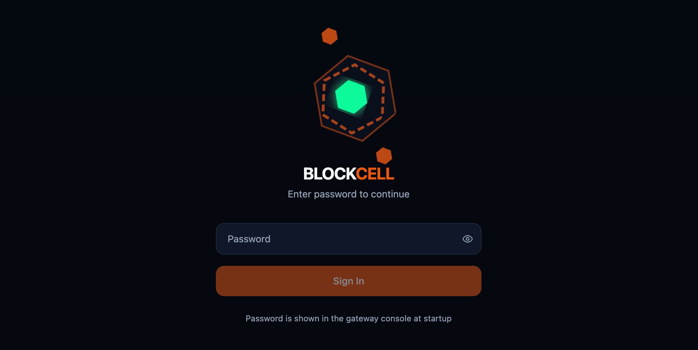

# BlockCell

<div align="center">

**用 Rust 构建的自进化 AI 多智能体框架**

[](LICENSE)
[](https://www.rust-lang.org)
[](https://github.com/blockcell-labs/blockcell)

[官网](https://blockcell.dev) • [文档](https://blockcell.dev/docs) • [English](README.en.md)

**最新版本**：v0.1.8 • [下载 Release](https://github.com/blockcell-labs/blockcell/releases/tag/v0.1.8) • [更新日志](CHANGELOG.md)

</div>

---

## 🌟 BlockCell 有何不同

BlockCell 不只是一个聊天机器人 — 它是一个**真正能执行任务**的 AI 智能体。当 ChatGPT 只能告诉你该做什么时，BlockCell 可以：

- 📁 读写你系统上的文件
- 🌐 控制浏览器并自动化网页任务
- 📊 分析 Excel/PDF 文件并生成报表
- 💰 监控股票价格和加密货币市场
- 📧 跨平台发送邮件和消息
- 🔄 **自我进化** — 自动修复 bug 并部署改进

```
你："监控特斯拉股价，如果跌破 200 美元就提醒我"
BlockCell: ✓ 设置监控 → ✓ 每小时检查价格 → ✓ 发送 Telegram 提醒
```

---

## 🎯 名字由来

> *"极简的单元，极繁的整体。"*

**BlockCell** 的灵感来自《星际之门》中的**复制者（Replicators）** — 由无数微小、独立的模块块组成的机械生命体。每个模块本身很简单，但组合在一起就能形成战舰、士兵和智慧。它们瞬间适应，进化速度超过任何武器，永远无法被摧毁。

这种哲学贯穿于整个框架：

- **Block** → 不可变的 Rust 宿主：安全、稳定、确定性
- **Cell** → 可变的技能层：有生命、能自我修复、无限进化

传统软件在发布的那一刻就停止了生长。BlockCell 是**活的**。

→ [完整命名故事](https://blockcell.dev/naming-story)

---

## ✨ 核心特性

### 🛠️ 内置 60+ 工具

- **文件与系统**：读写文件、执行命令、处理 Excel/Word/PDF
- **网页与浏览器**：网页抓取、无头 Chrome 自动化（CDP）、HTTP 请求
- **金融数据**：实时股票行情（A股/港股/美股）、加密货币价格、DeFi 数据
- **通讯**：邮件（SMTP/IMAP）、Telegram、Slack、Discord、飞书
- **媒体**：截图、语音转文字（Whisper）、图表生成、Office 文件创建
- **AI 增强**：图像理解、文字转语音、OCR

### 🧬 自我进化系统

当 AI 在执行任务时反复失败，BlockCell 可以：

1. 检测错误模式
2. 使用 LLM 生成改进的代码
3. 自动审计、编译和测试
4. 通过金丝雀部署（10% → 50% → 100%）
5. 如果性能下降则自动回滚

```
检测到错误 → LLM 生成修复 → 审计 → 测试 → 金丝雀部署 → 全量发布
                                        ↓ 失败时
                                      自动回滚
```

### 🧠 Ghost Native 自学习

BlockCell 可以在真实使用中沉淀长期有效的经验：

- 将稳定用户偏好写入 `USER.md`
- 将项目事实、环境约定和踩坑记录写入 `MEMORY.md`
- Ghost 后台 Review 只沉淀声明性记忆；可复用流程由主 Agent 或独立 Skill Learning 通道整理成 workspace skills
- 后台 review 失败不影响当前对话，所有自动写入都有审计、快照和撤销入口

### 🧭 ModelRouter 智能路由与连接阶段降级

当你配置多个模型时，BlockCell 可以按策略选择合适的 Provider：

- `manual`：沿用 Provider Pool 的优先级 + 权重选择
- `cost_optimized`：短上下文（≤4 条消息）优先使用低成本模型，长上下文回到主力模型
- `quality_first`：优先使用高优先级主力模型
- `latency_first`：优先选择近期快速成功的条目，无历史数据时回退到优先级选择

主对话 LLM 调用还支持**连接阶段自动降级**：如果首选 Provider 在建立流之前出现连接、超时、DNS 等错误，会立即尝试下一个可用 Provider；一旦流式输出已经开始，中途错误不会切换模型，避免把部分输出和另一个模型的结果混在一起。

### 🪝 Hook 生命周期事件

BlockCell 可以通过 `~/.blockcell/hooks.yaml` 在关键生命周期事件上执行本机命令：

- `pre_tool_use` / `post_tool_use`：工具实际执行前后触发，支持按工具名 glob 匹配
- `session_start` / `session_end` / `user_prompt` / `agent_stop` / `compaction`：会话、消息与压缩级事件
- 支持 `{tool_name}`、`{session_id}`、`{cwd}`、`{command}`、`{file_path}`、`{result}` 等模板变量
- Hook 失败或超时不会阻断 agent 主流程，适合审计、格式化、通知和外部日志接入

### 🧩 Runtime Kernel：可观察、可拦截、可回放

v0.1.8 把 Agent 运行时拆成可组合的内核，执行过程不再只剩一个最终回答：

- **统一事件总线**：`turn/start`、`step/end`、`tool/pre-execute`、`model/response`、`memory/write`、`subagent/completed` 等生命周期事件按优先级与作用域派发，listener 带超时与故障隔离
- **会话事件日志**：追加式 JSONL 侧车（`schema_version` + 单调 `seq`），与 transcript 并行演进，支持保留期清理
- **回放与评估**：`blockcell session list / replay / verify` 可重放回合、步骤、模型请求与工具调用，输出 token、时长、重试等指标；`verify` 校验事件日志投影与 transcript 是否一致
- **Guarded Tool Pipeline**：工具开关、Policy、危险操作、路径访问、Shell 提权集中到一条管线，工具本身不再各自处理权限与审计
- **失败语义**：区分失败 / 被拒绝 / 取消 / 超时 / 未开始 / 结果未知；结果未知时先对账再决定是否重试
- **能力 seam**：沙箱、Shell、文件系统、浏览器、子 Agent 均以可替换接口暴露，本机实现可被替换

### 🛡️ 沙箱与执行环境

- 沙箱后端：macOS Seatbelt、Linux Landlock + seccomp；不可用时要求显式审批
- **执行环境与“是否需要确认”解耦**：`exec` 家族如实声明 FullAccess，只有 `sandbox_policy=full-access` 的 `shell` 逐次确认，危险命令仍按内容把关
- 持久 shell 会话按会话隔离，不再跨通道复用
- 技能脚本内的嵌套工具调用同样受 Policy、危险操作判定与审计约束

### 🔐 可控执行与审计

v0.1.8 把安全边界收口到统一原语：

- Tool Policy 支持工具名 glob、渠道条件、路径条件、`allow` / `ask` / `deny` 决策和规则组继承，优先级为 **Deny > Ask > Allow**
- 全局 Token / 成本预算按会话跟踪，子 Agent 的消耗归并到发起会话，后台代理无法绕过
- 审计日志支持 SHA-256 hash chain 校验（跨进程互斥），记录会话、Provider 调用、预算事件，以及每次工具调用的执行环境与结论
- 路径展开、文件名净化、Python 字符串转义、SSRF 校验、配置密钥掩码统一走共享原语，不再各模块各写一份
- Gateway API 默认更严格，普通 API 不再接受 URL `?token=`，应使用 `Authorization: Bearer <token>`

### 🤖 多智能体与自定义 Agent

- 支持 typed agent、forked subagent、checkpoint 和链式取消
- 支持用户级与项目级 Markdown agent 定义
- 每类 agent 可单独配置工具范围、模型、技能、MCP、one-shot 和权限模式
- CLI、Gateway 和 WebUI 可接收后台任务进度事件

### 🌐 多渠道支持

将 BlockCell 作为守护进程运行，连接到：

- **Telegram**（长轮询）
- **WhatsApp**（桥接 WebSocket）
- **飞书**（长连接 WebSocket）
- **Lark**（Webhook）
- **Slack**（Socket Mode，缺少 `appToken` 时可轮询回退）
- **Discord**（Gateway WebSocket）
- **钉钉**（Stream SDK）
- **企业微信**（WeCom，轮询/Webhook）
- **QQ**（官方机器人 Gateway/Webhook）
- **NapCatQQ**（OneBot 11 WebSocket/HTTP）
- **微信**（Weixin iLink Bot API，扫码登录/长轮询）

#### 📖 渠道接入指南

每个渠道都有详细的配置文档（中英双语）：

**中文文档** | **English Docs**
--- | ---
[Telegram 配置](docs/channels/zh/01_telegram.md) | [Telegram Setup](docs/channels/en/01_telegram.md)
[Discord 配置](docs/channels/zh/02_discord.md) | [Discord Setup](docs/channels/en/02_discord.md)
[Slack 配置](docs/channels/zh/03_slack.md) | [Slack Setup](docs/channels/en/03_slack.md)
[飞书配置](docs/channels/zh/04_feishu.md) | [Feishu Setup](docs/channels/en/04_feishu.md)
[钉钉配置](docs/channels/zh/05_dingtalk.md) | [DingTalk Setup](docs/channels/en/05_dingtalk.md)
[企业微信配置](docs/channels/zh/06_wecom.md) | [WeCom Setup](docs/channels/en/06_wecom.md)
[WhatsApp 配置](docs/channels/zh/07_whatsapp.md) | [WhatsApp Setup](docs/channels/en/07_whatsapp.md)
[Lark 配置](docs/channels/zh/08_lark.md) | [Lark Setup](docs/channels/en/08_lark.md)
[QQ 配置](docs/channels/zh/09_qq.md) | [QQ Setup](docs/channels/en/09_qq.md)
[NapCatQQ 配置](docs/channels/zh/10_napcatqq.md) | [NapCatQQ Setup](docs/channels/en/10_napcatqq.md)
[微信配置](docs/channels/zh/11_weixin.md) | [Weixin Setup](docs/channels/en/11_weixin.md)

每份指南包含：
- 📝 应用创建步骤
- 🔑 权限配置说明
- ⚙️ Blockcell 配置示例
- 💬 交互方式说明
- ⚠️ 常见问题排查

### 🏗️ Rust 宿主 + 三种技能形态

```
┌─────────────────────────────────────────────┐
│         Rust 宿主（可信核心）                │
│  消息总线 | 工具注册表 | 调度器              │
│  存储 | 审计 | 安全                          │
└─────────────────────────────────────────────┘
                     ↕
┌─────────────────────────────────────────────┐
│         技能层（可变层）                     │
│  纯 Markdown | Markdown + Rhai              │
│  Markdown + Python                          │
└─────────────────────────────────────────────┘
```

- **Rust 宿主**：不可变、安全、高性能的基础
- **纯 Markdown 技能**：只用 `SKILL.md` 定义行为说明，适合知识型与流程型技能
- **Markdown + Rhai 技能**：使用 `SKILL.md` + `SKILL.rhai` 实现结构化编排与工具调用
- **Markdown + Python 技能**：使用 `SKILL.md` + Python 脚本承载更复杂的数据处理、集成与执行逻辑
- **社区技能兼容**：支持 skill pack/category 递归扫描，兼容 OpenClaw 与 gbrain skill 格式

---

## 🚀 快速开始

### 安装（推荐）

```bash
curl -fsSL https://raw.githubusercontent.com/blockcell-labs/blockcell/main/install.sh | sh
```

这会将 `blockcell` 安装到 `~/.local/bin`。自定义安装位置：

```bash
curl -fsSL https://raw.githubusercontent.com/blockcell-labs/blockcell/main/install.sh | BLOCKCELL_INSTALL_DIR="$HOME/bin" sh
```

### 从源码构建

**前置要求**：Rust 1.96+

```bash
git clone https://github.com/blockcell-labs/blockcell.git
cd blockcell
cargo build --release
```

### 首次运行

```bash
# 推荐：交互式向导
blockcell setup

# 启动交互模式
blockcell agent
```

`setup` 会创建 `~/.blockcell/` 目录、写入 provider 配置，并在你启用外部渠道时自动补默认 owner 绑定。

### 守护进程模式（带 WebUI）

```bash
blockcell gateway
```

- **API 服务器**：`http://localhost:18790`
- **WebUI**：`http://localhost:18791`
- **默认路由**：CLI / WebUI / WebSocket 进入 `default` agent；外部渠道优先按 `channelAccountOwners.<channel>.<accountId>` 路由，未命中时回退到 `channelOwners.<channel>`

### 常用命令

| 命令 | 说明 |
| --- | --- |
| `blockcell setup` | 交互式向导：初始化配置、选择 provider、可选配置渠道 |
| `blockcell agent` | 交互式对话；`-m <msg>` 单次执行 |
| `blockcell gateway` | 守护进程：API + WebUI + 外部渠道接入 |
| `blockcell status` / `doctor` | 查看配置状态 / 环境诊断 |
| `blockcell config` | 查看、修改或打开 `config.json5` |
| `blockcell tools` / `mcp` | 管理内置工具开关与 MCP 服务器 |
| `blockcell session list/replay/verify` | 列出、回放、校验会话事件日志 |
| `blockcell memory` / `skills` / `cron` | 记忆、技能与定时任务管理 |
| `blockcell upgrade` | 升级到最新 Release |

完整命令参考见 [CLI 参考](docs/17_cli_reference.md)。

---

## 📸 项目截图

<div align="center">

### 守护进程模式


### WebUI 界面




</div>

---

## ⚙️ 配置说明

最小配置示例（`~/.blockcell/config.json5`）：

```json
{
  "providers": {
    "deepseek": {
      "apiKey": "YOUR_API_KEY",
      "apiBase": "https://api.deepseek.com"
    }
  },
  "agents": {
    "defaults": {
      "model": "deepseek-flash",
      "provider": "deepseek",
      "maxContextTokens": 1048576,
      "reasoningEffort": "high"
    }
  }
}
```

多模型路由示例：

```json
{
  "agents": {
    "defaults": {
      "routingStrategy": "cost_optimized",
      "modelPool": [
        { "model": "deepseek-flash", "provider": "deepseek", "priority": 1, "weight": 3 },
        { "model": "gpt-6-luna", "provider": "openai", "priority": 5, "weight": 1 }
      ]
    }
  },
  "providers": {
    "deepseek": { "apiKey": "YOUR_DEEPSEEK_KEY" },
    "openai": { "apiKey": "YOUR_OPENAI_KEY" }
  }
}
```

`cost_optimized` 会让短对话优先使用低优先级的便宜条目，复杂长上下文仍优先使用主力模型。更多策略与降级细节见 [ModelRouter 智能路由与自动降级](docs/28_model_router.md)。

如果要启用多 agent 与外部渠道，建议按代码当前支持的结构补充：

<details>
<summary>展开示例：“2 个 agent + 2 个 Telegram 账号”的完整配置</summary>

```json
{
  "agents": {
    "defaults": {
      "model": "deepseek-flash",
      "provider": "deepseek",
      "maxContextTokens": 1048576,
      "reasoningEffort": "high"
    },
    "list": [
      {
        "id": "default",
        "enabled": true,
        "name": "General Assistant",
        "intentProfile": "default"
      },
      {
        "id": "ops",
        "enabled": true,
        "name": "Operations Assistant",
        "intentProfile": "ops",
        "maxToolIterations": 12
      }
    ]
  },
  "intentRouter": {
    "enabled": true,
    "defaultProfile": "default",
    "agentProfiles": {
      "default": "default",
      "ops": "ops"
    },
    "profiles": {
      "default": {
        "coreTools": ["read_file", "write_file", "list_dir", "web_fetch", "message"],
        "intentTools": {
          "Chat": { "inheritBase": false, "tools": [] },
          "FileOps": ["read_file", "write_file", "list_dir"],
          "WebSearch": ["web_search", "web_fetch"]
        }
      },
      "ops": {
        "coreTools": ["http_request", "message", "notification", "alert_rule", "list_tasks"],
        "intentTools": {
          "DevOps": ["http_request", "notification", "alert_rule", "list_tasks"],
          "Communication": ["message", "notification"]
        },
        "denyTools": ["write_file", "exec"]
      }
    }
  },
  "channels": {
    "telegram": {
      "enabled": true,
      "accounts": {
        "main_bot": {
          "enabled": true,
          "token": "123456:MAIN_BOT_TOKEN",
          "allowFrom": ["alice"]
        },
        "ops_bot": {
          "enabled": true,
          "token": "123456:OPS_BOT_TOKEN",
          "allowFrom": ["oncall_group"]
        }
      },
      "defaultAccountId": "main_bot"
    }
  },
  "channelOwners": {
    "telegram": "default"
  },
  "channelAccountOwners": {
    "telegram": {
      "main_bot": "default",
      "ops_bot": "ops"
    }
  },
  "gateway": {
    "apiToken": "YOUR_STABLE_API_TOKEN",
    "webuiPass": "YOUR_WEBUI_PASSWORD"
  }
}
```

</details>

这里要注意：

- `agents.list` 里的字段要使用代码实际支持的字段，例如 `id`、`enabled`、`name`、`intentProfile`、`maxToolIterations`
- `intentRouter` 当前支持 `enabled`、`defaultProfile`、`agentProfiles`、`profiles`
- `profiles.<name>` 里可以配置 `coreTools`、`intentTools`、`denyTools`
- Telegram 多账号要写在 `channels.telegram.accounts` 下，每个账号使用 `enabled`、`token`、`allowFrom`
- 渠道路由使用 `channelOwners`
- 账号级覆盖路由使用 `channelAccountOwners`
- 如果你只需要单 agent，请直接看上面的最小配置，或者阅读 `QUICKSTART.zh-CN.md`
- 如果你需要完整多 agent 部署说明，请阅读 `QUICKSTART.multi-agent.zh-CN.md`

### 支持的 LLM 提供商

- **OpenAI**（GPT-5.5、GPT-5.4-mini、o1、o3）
- **Anthropic**（Claude Opus 4.8、Claude Sonnet 4.6）
- **Google Gemini**（Gemini 3.1 Pro、Gemini 3.5 Flash）
- **DeepSeek**（DeepSeek V4 Pro、V3、R1）
- **Kimi/Moonshot**（月之暗面）
- **MiniMax**（[MiniMax M3.1 Flash](https://www.minimaxi.com/)）
- **智谱 AI**（[GLM-5](https://bigmodel.cn/)）
- **通义千问**（Qwen）
- **xAI**（Grok）
- **Mistral**
- **Groq**
- **硅基流动**（[SiliconFlow](https://siliconflow.cn/)）
- **Ollama**（本地模型，完全离线）
- **OpenRouter**（统一访问 200+ 模型）

---

## 🔧 可选依赖

要使用完整功能，请安装这些工具：

- **图表**：Python 3 + `matplotlib` / `plotly`
- **Office**：Python 3 + `python-pptx` / `openpyxl`（DOCX 为原生生成，无需 Python）
- **音频**：`ffmpeg` + `whisper`（或使用 API 后端）
- **浏览器**：Chrome/Chromium（用于 CDP 自动化）
- **仅 macOS**：`chrome_control`、`app_control`

---

## 📚 文档

- [完整系列索引](docs/00_index.md)
- [什么是 blockcell？](docs/01_what_is_blockcell.md)
- [快速开始指南（单 agent）](QUICKSTART.zh-CN.md)
- [多 agent 快速开始](QUICKSTART.multi-agent.zh-CN.md)
- [架构深度解析](docs/12_architecture.md)
- [工具系统](docs/03_tools_system.md)
- [技能系统](docs/04_skill_system.md)
- [记忆系统](docs/05_memory_system.md)
- [Ghost Native 学习闭环](docs/27_ghost_learning_design.md)
- [ModelRouter 智能路由与自动降级](docs/28_model_router.md)
- [Provider Pool](docs/20_provider_pool.md)
- [Intent Router 与 Profile](docs/21_intent_router_profiles.md)
- [Hook 生命周期事件系统](docs/29_hook_system.md)
- [MCP 服务器](docs/19_mcp_servers.md)
- [渠道配置](docs/06_channels.md)
- [浏览器自动化](docs/07_browser_automation.md)
- [Gateway 模式](docs/08_gateway_mode.md)
- [自我进化](docs/09_self_evolution.md)
- [路径访问策略](docs/22_path_access_policy.md)
- [CLI 参考](docs/17_cli_reference.md)

---

## 🏗️ 项目结构

```
blockcell/
├── bin/blockcell/          # CLI 入口
├── crates/
│   ├── core/               # 配置、路径、共享类型
│   ├── agent/              # Agent 运行时和安全
│   ├── tools/              # 60+ 内置工具
│   ├── skills/             # 技能加载、OpenClaw 兼容与进化
│   ├── storage/            # SQLite 记忆、会话、RabitQ 向量索引
│   ├── channels/           # 消息渠道适配器
│   ├── providers/          # LLM 提供商客户端与路由
│   ├── scheduler/          # Cron 与心跳
│   └── updater/            # 自升级系统
├── skills/                 # 内置技能（Markdown / Rhai / Python）
├── webui/                  # Web 控制台（Vite + React）
├── docs/                   # 中英文档
└── tests/                  # 端到端与编码能力评测
```

---

## 🤝 贡献

我们欢迎贡献！以下是开始的方法：

1. Fork 本仓库
2. 创建特性分支（`git checkout -b feature/amazing-feature`）
3. 提交你的更改（`git commit -m 'Add amazing feature'`）
4. 推送到分支（`git push origin feature/amazing-feature`）
5. 打开 Pull Request

详细指南请参阅 [CONTRIBUTING.md](CONTRIBUTING.md)。

---

## 🔒 安全性

- **路径安全**：自动验证文件系统访问
- **沙箱执行**：Rhai 脚本在隔离环境中运行，Shell 可运行在 Seatbelt / Landlock 后端
- **审计日志**：所有工具执行都被记录，含执行环境与结论
- **会话回放**：`blockcell session replay` 可回放每次执行的完整链路，便于事后审计
- **网关认证**：API 访问支持 Bearer token

在交互模式下，`~/.blockcell/workspace` 外的操作需要明确确认。

---

## 📊 使用场景

### 金融自动化
```
"监控茅台股价，如果跌破 1500 就提醒我"
"分析我的 portfolio.xlsx 并建议再平衡"
```

### 数据处理
```
"读取 ~/Documents 中的所有 PDF 并创建摘要表格"
"从 data.csv 生成带图表的销售报告"
```

### 网页自动化
```
"每小时检查公司网站，如果宕机就提醒"
"用 sheet.xlsx 中的数据填写 example.com 上的表单"
```

### 通讯
```
"每天发送站会总结到 Slack #team-updates"
"将紧急邮件转发到我的 Telegram"
```

---

## 🌍 社区

- **GitHub**：[blockcell-labs/blockcell](https://github.com/blockcell-labs/blockcell)
- **官网**：[blockcell.dev](https://blockcell.dev)
- **Discord**：[加入我们的社区](https://discord.gg/E8TXuHk9QZ)
- **Twitter/X**：[@blockcell_ai](https://x.com/blockcell_ai)

---

## 📝 许可证

本项目采用 MIT 许可证 - 详见 [LICENSE](LICENSE) 文件。

---

## 🙏 致谢

BlockCell 站在巨人的肩膀上：

- [Rust](https://www.rust-lang.org/) - 系统编程语言
- [Rhai](https://rhai.rs/) - 嵌入式脚本引擎
- [Tokio](https://tokio.rs/) - 异步运行时
- [SQLite](https://www.sqlite.org/) - 嵌入式数据库
- [OpenClaw](https://github.com/openclaw/openclaw) - 技能格式兼容来源
- [NanoClaw](https://github.com/nanocoai/nanoclaw) - 轻量化的 OpenClaw 替代实现

---

<div align="center">

**如果你觉得 BlockCell 有用，请在 GitHub 上给我们一个 ⭐️！**

[⭐ 在 GitHub 上 Star](https://github.com/blockcell-labs/blockcell) • [📖 阅读文档](https://blockcell.dev/docs) • [💬 加入 Discord](https://discord.gg/E8TXuHk9QZ)

</div>
