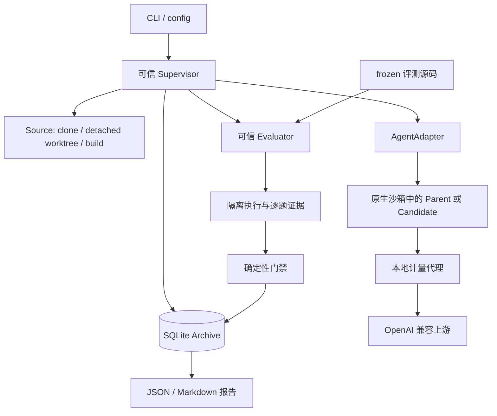
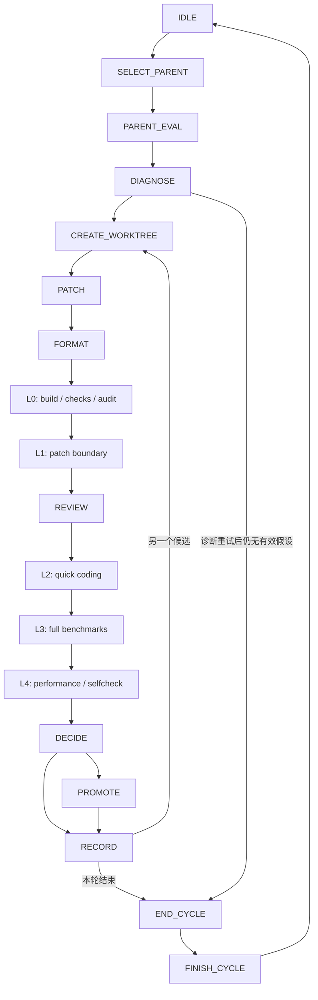

# 架构与状态机

[文档首页](README.md) · 上一篇：[快速开始](02-quickstart.md) · 下一篇：[评测与晋级](04-evaluation.md)

## 控制面与执行面

Supervisor 决定“运行什么、比较什么、何时停止”；Agent 负责执行自然语言任务。Agent 输出、候选源码和构建脚本都不能作为可信判定依据。



图中的“可信”是部署前提，不是形式化安全证明。配置、初始源码和外部评测器都必须由操作者审核。隔离的具体边界见 [SECURITY.md](../SECURITY.md)。

## 模块地图

| 模块 | 主要职责 |
|---|---|
| [__main__.py](../__main__.py)、[config.py](../config.py) | CLI、环境覆盖、配置校验和评测配置 hash |
| [supervisor.py](../supervisor.py) | 状态迁移、候选循环、恢复、Parent 资格与决策编排 |
| [source.py](../source.py) | clone、SHA 锁定、worktree、编译、diff、detached 提交和进程组清理 |
| [archive.py](../archive.py)、[locking.py](../locking.py) | SQLite 存档、跨进程工作区锁 |
| [agent_adapter.py](../agent_adapter.py) | 指定二进制的调用、隔离 HOME、运行目录和指标采集 |
| [isolation.py](../isolation.py)、[native_sandbox.py](../native_sandbox.py) | 计量代理、环境清理、Linux/macOS 沙箱 |
| [http_transport.py](../http_transport.py) | 上游 HTTP 传输与可选原生传输桥接 |
| [diagnosis.py](../diagnosis.py) | Hypothesis 提取、字段校验与失败假设相似性过滤 |
| [evaluator.py](../evaluator.py)、[adapters/](../adapters/) | 可信评测编排、结果归一化、报告与缓存 |
| [eab_launcher.py](../eab_launcher.py)、[eab_isolation.py](../eab_isolation.py) | EAB 网关、服务与评测目录隔离 |
| [gates.py](../gates.py)、[selector.py](../selector.py) | 配对投票、补丁与性能规则、Parent 抽样 |
| [report.py](../report.py)、[preflight.py](../preflight.py) | 实验汇总与前置环境检查 |

建议阅读顺序：CLI → `Supervisor.run()` → `AgentAdapter.call()` → `Evaluator.evaluate()` → `gates.decide()`，最后再追踪具体沙箱与适配器。

## 状态机

状态在动作执行前持久化；恢复会从保存的阶段继续。下图省略错误分支，保留源码中的阶段名：



初始化另有 `BUILD_GENESIS0`。预算耗尽、周期到期、全局停滞或父代资格检查失败且无法回退时，可进入 `STOPPED`。

## 结构化改进假设

`diagnose` 要求恰好两个 Hypothesis，并校验 `lineage_parent` 与当前 Parent 一致。单个假设的形状如下；实际输出是两个此类对象组成的 JSON 数组：

```json
{
  "id": "hypothesis-a",
  "lineage_parent": "genesis-0",
  "failure_ids": ["coding_eval/example-01"],
  "evidence": ["允许用于诊断的失败现象"],
  "suspected_files": ["crates/agent/src/example.rs"],
  "root_cause": "待验证的根因解释",
  "proposed_change": "一个范围明确的小改动",
  "expected_effect": "预计修复的行为",
  "verification": ["聚焦测试与潜在回归检查"],
  "risk": "改动风险与不确定性",
  "not_duplicate_of": []
}
```

上述文件和任务名只是协议示例。当前校验会检查必需字段、主要列表类型、改动描述和非空文件列表，并过滤类似的历史失败假设；它不会验证模型根因解释必然正确。后续实际 diff 与独立评测才是证据。

## 执行与恢复细节

几个影响理解的实现细节：

- **Parent 先验资格。** Supervisor 选出父代后执行 `--help` 和标准修改自检。选中的父代不合格时标为 `UNFIT`，回退到 Genesis-0 并执行同样的检查。回退失败则停止。连续多轮全部候选编译失败也会淘汰 Parent。
- **周期时限。** Supervisor 在阶段入口检查剩余时间，并据此限制构建、评测及验收子进程。子进程使用周期时限退出会进入 `STOPPED`，清理进程可能额外耗时。
- **构建先于补丁路径门禁。** 当前先运行 L0，再在 L1 检查补丁规模与路径。因此路径规则不能替代候选构建的沙箱隔离。
- **REVIEW 仍是不可信调用。** Supervisor 比较评审前后完整 diff；评审若修改源码会拒绝候选。
- **两候选串行。** 共享编译 target，不能并行 cargo；请求并发与候选并发是不同层次。
- **恢复不保证外部副作用恰好一次。** 状态、资格和统计尽量幂等；中断时未完成的工具步骤仍可能重跑。

## 数据与谱系

Archive 使用四张主要表：

| 表 | 保存的信息 |
|---|---|
| `agents` | Agent 身份、提交 SHA、Parent、假设、状态、二进制、资格和停滞计数 |
| `evaluations` | 一次 benchmark/run_idx 的配置身份、汇总与完整 JSON |
| `task_results` | 逐题通过、失败原因和轨迹路径 |
| `cycle_state` | 当前阶段和恢复 payload，单行状态 |

Agent 结果状态包括 `CANDIDATE`、`PARENT`、`ARCHIVE`、`REJECTED`、`INCONCLUSIVE` 和 `UNFIT`；这些不是状态机的执行阶段。

独立 clone 位于 `repository/`，frozen 和候选均为 detached worktree。默认晋级会在独立 clone 中创建提交，归档合格候选也可能创建快照提交；不会修改原仓库、创建分支或自动 push。禁用 `promotion.commit_enabled` 后，晋级降级为归档，selector 也不再把归档版本纳入 Parent 池。

运行时新建的日志、数据库和测试目录会移出候选源码，避免被误计为补丁。该清理只针对识别出的运行产物，不意味着可以把任何生成目录都当作可信输入。

## 模型与执行隔离

真实 key 只交给 Supervisor 的代理。候选 HOME 中配置的是本地代理与占位 key；环境采用白名单，避免继承宿主 Provider 凭据。

构建沙箱不能访问外网，只读使用工具链与缓存。Agent 沙箱只能访问授权目录和本地代理；coding 验收另在离线沙箱中执行。macOS 的子进程继承外层 Seatbelt，不能依赖再次安装嵌套 Seatbelt。

共享 target 是受控实验中的工程折中，不是不同敌对租户之间的隔离机制。需要运行更强威胁模型下的任意原生代码时，应另外设计独立虚拟机或构建执行环境。
